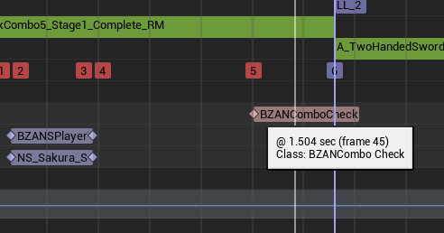

# 10 FPS에서 발생한 콤보 전환 실패와 몽타주 Blend Out

기록일: 2026-10-28 · 프로젝트: BladeZ · 엔진: UE 5.6

이 문서는 사용자 제공 로그와 재현 결과, 로컬 엔진 소스로 확인한 처리 흐름을 정리한 기술 기록이다. 특정 설정에서 관찰한 결과와 일반적인 동작 보장을 구분한다. 진단 당시의 로그를 보관하며, 현재 소스에 해당 로그가 남아 있다는 뜻은 아니다.

후속 기록: [입력 구간과 소비 시점 분리, 10·60 FPS 입력 윈도우 검증](../ComboInputWindow/README.md) — 2026-10-31. 이번 문서의 블렌드 아웃 사례와 후속 입력 수락 문제를 구분해 추적한다.

## 1. 짧은 요약 — 포트폴리오에 넣을 분량

> 무기 Trace 보간 검증 중 10 FPS에서 일부 공격 콤보가 연결되지 않는 현상을 발견했다. 입력 수신·버퍼 저장·노티파이 호출·섹션 전환 결과를 단계별로 기록해, 입력은 정상적으로 저장되지만 콤보 노티파이 실행 전에 자동 블렌드아웃으로 몽타주가 비활성화되는 것을 확인했다. Blend Out 설정을 바꾼 비교 실험으로 실패를 재현했고, Branching Point 적용 후 L_1의 노티파이 호출 위치가 약 1.750초에서 1.5043초로 바뀌고 콤보가 연결되는 것을 확인했다.

이 요약은 **원인 규명과 관찰한 검증 결과**를 설명한다. 명시적 종료 로직 구현 완료, 모든 FPS·공격에서의 해결, 실패율 개선 수치를 주장하지 않는다.

권장 배치:

- 포트폴리오 본문: 위 요약 또는 3~4문장과 대표 비교표만 사용한다.
- 상세 기술 기록: 이 문서에 실험 과정·설정·근거·한계를 남긴다.
- 면접용 근거: `evidence/`의 원본 로그와 이미지에서 필요한 부분만 확인한다.

## 2. 최초 증상과 질문

- 무기 Trace 보간을 검증하던 10 FPS 환경에서 발견했다. Trace 보간이 원인이라는 증거는 없다.
- `L_1`으로 시작하는 콤보는 연속 클릭해도 다음 공격으로 이어지지 않았다.
- `L_1_1`으로 시작하면 일부 콤보는 이어졌다.
- 초기 가설은 입력 누락 또는 최신 입력 버퍼 처리 문제였다.

진단 시 구분한 지점은 다음과 같다.

| 이벤트 | 확인할 사항 |
| --- | --- |
| `InputReceived` | 게임의 입력 콜백까지 입력이 도달했는가? |
| `InputStored` | `NextInputType`과 `bHasNextInput`에 반영됐는가? |
| `NotifyEntered` | 콤보 노티파이가 실행됐으며, 그때 입력·몽타주 상태는 무엇인가? |
| `ComboDecision` | 다음 섹션을 찾았으며, 실제 섹션 점프가 적용됐는가? |
| `InputCleared` | 입력을 언제, 어떤 이유로 소비·초기화했는가? |
| `BlendOutStarted` / `AttackEnded` | 블렌드아웃 시작 알림과 완전 종료 알림은 언제 전달됐는가? |

각 이벤트에 실행 순서 `Seq`, 프레임 `Frame`, 시간, 현재 몽타주·섹션을 기록했다. 이후에는 중복 입력 로그를 줄이고, 비활성화 후에도 인스턴스 상태를 확인할 수 있는 필드를 추가했다.

## 3. 실험 결과 한눈에 보기

각 로그의 `Seq`와 `InstanceId`는 해당 실행 안에서만 해석한다. 서로 다른 로그 파일의 번호를 직접 시간순으로 연결하지 않는다.

| 실험 | 관찰 결과 | 해석 및 한계 |
| --- | --- | --- |
| 최초 로그 | L_1 노티파이는 호출됐지만 입력이 없고 몽타주가 비활성이었다. | 이 시도만으로 입력 저장 문제를 배제할 수 없다. |
| 입력이 저장된 실패 로그 | L_1에서 입력 저장·갱신 후, 비활성 상태에서 노티파이 호출 및 점프 실패. | 입력 누락·버퍼 조기 초기화·매핑 실패가 직접 원인은 아니었다. 이 로그에는 Blend Out 설정값이 없다. |
| Blend Out Time = 0 | L_1과 L_1_1에서 다음 콤보로 전환 성공. 종료 로그에서 Trigger Time = -1 확인. | 제공된 시도에서 자동 블렌드아웃과 콤보 전환 충돌이 사라졌다. |
| Blend Out Time = 0.1, Trigger Time = -1 | L_1 → LL_2가 4/4회 실패. LLL_3 → LLLL_4도 1회 실패. | 모두 입력이 있으나 노티파이 시점에 `Stopped=1`, `AttackActive=0`. 이 횟수는 첨부 로그 내 관찰 수다. |
| Blend Out Time = 0.5, Trigger Time = -1 | L_1_1 세 시도 모두 시작 다음 프레임에 블렌드아웃 알림. | 공격 포즈의 가중치가 충분히 커지기 전에 감소. 노티파이는 호출됐고 입력은 없었으므로, 이 실험 자체는 점프 실패 검증이 아니다. |
| Blend Out Time = 0.1, Trigger Time = 0 | 사용자가 정상 연결을 확인했다고 보고. | 해당 설정을 보여주는 별도 원본 로그는 제공되지 않았다. |
| Branching Point로 변경 후 | L_1 호출 위치가 `1.5043`으로 바뀌고 네 번의 섹션 전환 성공. | 이 로그에는 Blend Out 설정·자동 블렌드아웃 사용 여부가 없다. 전환 성공을 Branching Point 하나의 효과로 단정하지 않는다. |
| 자동 블렌드아웃 해제 후 | 공격 후 걷기·대기 포즈로 복귀하지 않는 현상을 사용자 보고. | 입력이 없을 때 단순 반환하는 기존 코드와 종료 책임 부재로 설명된다. 명시적 종료 수정 후의 검증 로그는 아직 없다. |

## 4. 핵심 로그 분석

### A. 입력은 정상인데 전환이 실패했다

원본: [01-buffered-input-failure.txt](evidence/01-buffered-input-failure.txt)

| Seq | 핵심 내용 | 판단 |
| --- | --- | --- |
| 116–117 | `InputReceived` → `InputStored`, `HasNext=1 Buffered=Left` | 입력 수신·저장 성공 |
| 118–119 | 추가 입력 저장, `Overwritten=1` | 최신 입력 갱신 성공 |
| 120 | `NotifyEntered`, `HasNext=1`, `AttackActive=0` | 노티파이 호출 시 입력은 있으나 몽타주는 비활성 |
| 122 | `Key=L_1_0 Target=LL_2 Result=JumpNotApplied` | 매핑은 찾았으나 전환 실패 |
| 123 | `InputCleared Reason=CheckCombo.Consumed` | 전환 실패 후에도 입력은 소비됨 |
| 126 | `AttackEnded Interrupted=0` | 이후 공격 종료 통지 |

`Combo=LL_2`만으로 전환 성공을 판단하면 안 된다. 기존 `CheckCombo()`는 점프 적용 여부와 무관하게 `CurrentComboName`을 바꾼다. 실제 활성 섹션·인스턴스 섹션 및 점프 결과를 함께 봐야 한다.

### B. Blend Out 0과 0.1에서 결과가 달라졌다

원본: [02-blendout-zero.txt](evidence/02-blendout-zero.txt), [03-blendout-0.1.txt](evidence/03-blendout-0.1.txt)

| 항목 | Blend Out 0: Seq 36–37 | Blend Out 0.1: Seq 53–55 |
| --- | --- | --- |
| 노티파이 시점의 입력 | `HasNext=1 Buffered=Left` | 동일 |
| L_1 재생 위치 | `1.7501` | `InstancePos=1.7500` |
| 활성 상태 | `AttackActive=1 Stopped=0` | `AttackActive=0 Stopped=1` |
| 다음 섹션 | `LL_2` | `LL_2` |
| 결과 | `JumpApplied` | `JumpNotApplied` |

0.1 로그에서는 동일한 L_1 실패가 Seq 54, 59, 73, 78에서 반복됐다. L_1_1 → LL_2_1은 성공했지만, Seq 67–69에서는 LLL_3 → LLLL_4도 같은 이유로 실패했다. 따라서 특정 첫 공격의 입력 바인딩에만 국한된 문제가 아니다.

### C. 시작 알림이 나중에 찍혀도 상태는 먼저 바뀔 수 있다

0.1 로그의 순서는 다음과 같다. 아래는 핵심 필드만 추린 요약이며 원본 로그 전체가 아니다.

```text
Seq 53  NotifyEntered    InstanceSection=L_1  Stopped=1  AttackActive=0  HasNext=1
Seq 54  ComboDecision    Target=LL_2          Result=JumpNotApplied
Seq 55  BlendOutStarted  BlendOutTime=0.1     Interrupted=0  Delivery=MayBeQueued
```

블렌드아웃 시작 알림은 엔진 큐를 거쳐 노티파이 뒤에 전달될 수 있다. **출력된 콜백의 순서와 실제 상태 변경 순서는 다를 수 있다.** Seq 53에서 이미 `Stopped=1`이므로, 노티파이 실행 시점에는 정지·블렌드아웃 상태에 들어가 있었다.

### D. Blend Out 0.5에서 공격이 거의 보이지 않은 이유

원본: [04-blendout-0.5.txt](evidence/04-blendout-0.5.txt)

| 시작 후 경과 | Seq | 상태 |
| --- | --- | --- |
| 0.0초 | 278 | L_1_1 시작, `Weight=0` |
| 0.1초 | 279 | 블렌드아웃 시작 알림, `Stopped=1 Weight=0.25` |
| 0.3초 | 280–281 | 노티파이 호출, `Weight=0.0119`, 입력 없음으로 분기 건너뜀 |
| 0.6초 | 282 | 공격 종료 |

다른 두 시도도 같은 패턴이다. 재생 위치는 진행했지만 공격 포즈의 기여도가 매우 작아졌다. `Weight=0.0119`는 몽타주 가중치이며, 화면 전체 동작이 정확히 1.19%만 보인다는 의미는 아니다.

### E. Branching Point 적용 후 달라진 점

근거: [05-branching-point-summary.md](evidence/05-branching-point-summary.md) — 사용자가 채팅에 직접 제공한 로그의 필드 요약.

- Seq 1136: L_1의 `NotifyEntered`가 `Pos=1.5043`에서 실행됐다. 이전 Queued 실행의 약 `1.7500`과 다르다.
- Seq 1137: 같은 프레임에서 `LL_2`로 점프했다.
- 같은 `InstanceId=97`에서 `L_1 → LL_2 → LLL_3 → LLLL_4 → L_1_1` 전환이 모두 성공했다.
- Seq 1145: 입력이 없는 경우에는 여전히 `Skipped / NoBufferedInput`이다. 이 발췌에는 그 이후의 종료 로그가 없다.

확인된 것은 **L_1의 몽타주상 호출 위치 개선과 해당 실행의 콤보 연결 성공**이다. 모든 노티파이의 설정 변경 여부나 모든 조건에서의 안정성을 증명하지는 않는다.

## 5. 원인 설명

### 배치된 위치와 함수가 실행될 때의 재생 위치는 다르다



스크린샷의 콤보 노티파이는 약 1.504초에 배치돼 있다. Queued 노티파이는 업데이트 중 지나간 이벤트를 모았다가 실행하므로, 함수 진입 시 몽타주 위치가 배치 시점보다 뒤일 수 있다.

10 FPS에서 한 프레임은 약 0.1초다. **재생 속도가 일정한 2.5배라고 가정하면** 몽타주 위치는 한 프레임에 약 0.25초 진행한다. 프로젝트에는 재생 속도 커브가 있으므로 이 수치는 설명용 가정이며, 모든 구간의 실제 속도를 뜻하지 않는다.

```text
이전 위치 1.500 → 노티파이 위치 약 1.504 → 다음 위치 1.750
```

한 업데이트에서 노티파이 위치와 자동 블렌드아웃 조건을 함께 지나면, 블렌드아웃 상태 적용 후 Queued 노티파이가 실행될 수 있다. 노티파이 함수 내부의 연산이 오래 걸려서 생긴 문제가 아니다.

### Blend Out의 시간과 시작 조건

| 설정 | 의미 |
| --- | --- |
| Blend Out Time | 종료 시 포즈 가중치를 줄이는 시간 설정 |
| Blend Out Trigger Time < 0 | Blend Out Time을 자동 시작 조건에도 사용 |
| Blend Out Trigger Time = 0 | 종료 지점에서 자동 블렌드아웃 시작 |
| Blend Out Trigger Time > 0 | 종료까지 남은 실제 재생 시간이 해당 값 이하일 때 시작 |

자동으로 이어질 다음 섹션이 없는 경우, 엔진은 현재 섹션 끝까지 남은 시간을 검사한다. 일정 재생 속도·Time Stretch 없음이라는 가정에서는 대략 다음과 같다.

```text
남은 실제 재생 시간 = (섹션 끝 위치 − 현재 위치) / 재생 속도
```

예를 들어 끝이 약 1.7673초, 속도가 2.5배, 시작 기준이 0.1초라면 기준 위치는 약 `1.7673 − 0.1 × 2.5 = 1.5173초`다. 이는 기준 위치 계산이며 실제 상태 적용 순간은 프레임 업데이트와 엔진 처리 순서의 영향을 받는다.

블렌드아웃이 시작된 인스턴스는 마지막 포즈를 계속 반영할 수 있지만 활성 몽타주 목록에서는 빠진다. `Montage_JumpToSection()`은 활성 인스턴스를 대상으로 동작하므로, 그 이후의 점프 요청은 적용되지 않는다.

### Branching Point가 해결하는 범위

Branching Point는 재생 진행을 해당 이벤트 위치까지 나누어 처리하고, 함수가 섹션을 바꿨으면 바뀐 위치에서 남은 업데이트를 이어간다. 실제 시간의 별도 타이머나 렌더링 FPS 증가가 아니라 **몽타주 내부 처리 위치와 순서의 제어**다.

이미 이벤트 위치 전에 블렌드아웃이 시작됐다면 Branching Point만으로 되돌릴 수 없다. 종료 시점을 제어하는 것과 분기 실행 위치를 맞추는 것은 별개의 문제다.

## 6. 로그 필드 해석 시 주의점

| 필드 | 의미 / 주의점 |
| --- | --- |
| `Section`, `AttackSection` | 활성 몽타주 조회 결과. 비활성화 뒤 `None`이어도 에셋이 사라졌다는 뜻은 아니다. |
| `Combo` | 코드가 기억하는 `CurrentComboName`. 실제 재생 섹션과 어긋날 수 있다. |
| `InstanceSection`, `InstancePos` | 아직 조회되는 공격 인스턴스의 섹션·위치. 비활성 상태도 관찰할 수 있다. |
| `Stopped=1` | 인스턴스가 정지·블렌드아웃 상태. 화면상 기여도가 0이라는 뜻은 아니다. |
| `Stopped=-1`, `InstanceId=-1` | 진단 코드에서 해당 인스턴스를 찾지 못한 경우의 표시다. |
| `Weight` | 포즈에 반영되는 몽타주 가중치. `1`이어도 이미 정지 상태일 수 있다. |
| `HasNext`, `Buffered` | 소비 가능한 입력의 존재 여부와 값. |
| `Consumed=1` | 기존 코드가 입력을 소비하는 경로에 진입했다는 뜻. 전환 성공은 `JumpApplied`를 함께 확인해야 한다. |
| `NoMapping.RandomFirstCombo` | 매핑이 없을 때 첫 공격을 임의 선택하는 기존 분기. 오류라고 단정하지 않는다. |
| `Seq`, `Frame` | 로그 호출 순서와 프레임. 큐 알림의 내부 상태 변경 시각까지 나타내지는 않는다. |

## 7. 현재 결론과 남은 선택

### 확인한 결론

1. 이번 실패 사례에서는 입력 수신·최신 입력 저장·노티파이 호출이 정상 수행됐다.
2. 실패한 분기에서는 다음 섹션 매핑도 존재했지만, 노티파이 호출 시 몽타주가 이미 비활성이어서 점프가 적용되지 않았다.
3. Blend Out 0과 0.1의 비교, `Stopped` 상태 관찰을 통해 자동 종료 타이밍과 콤보 처리 시점의 충돌을 확인했다.
4. Branching Point 변경 후 L_1의 노티파이 실행 위치가 배치 위치 부근으로 바뀌었다.

### 요구에 맞는 종료 정책 — 아직 최종 구현·검증 완료로 기록하지 않음

원하는 전환 시점은 유지한다. 그 시점에서 입력이 있으면 다음 공격으로, 없으면 공격 종료 또는 마무리 구간으로 분기한다.

```text
입력 저장 → 원하는 콤보 체크 위치
                ├─ 입력 있음 → 다음 공격 섹션으로 점프
                └─ 입력 없음 → 종료 요청 / 마무리 구간 후 종료
```

- 자동 블렌드아웃을 유지한다면, 콤보 판단보다 먼저 시작되지 않도록 Trigger Time과 종료 구간을 설계한다. `Trigger Time=0`은 사용자 재현에서 효과가 있었다.
- 자동 블렌드아웃을 끈다면, 종료 책임이 코드로 넘어간다. 기존처럼 입력이 없을 때 단순 반환하면 마지막 포즈가 유지될 수 있다.
- 입력 없는 분기에서 `Montage_Stop(BlendTime, AttackMontage)`을 호출하는 방법이 있다. 먼저 포인터 유효성을 확인해야 하며, 이는 노티파이 호출 시점부터 종료하는 선택이다.
- 체크 뒤 마무리 동작을 더 보여주려면 별도 마무리 구간을 거쳐 종료한다.
- 기존 `OnAttackEnded()`의 상태 정리까지 이어지는지 확인한다. 마지막 콤보, 피격 중단 등도 종료 경로가 필요하다.
- 섹션 점프 자체가 공격 간 포즈를 자동으로 블렌딩해 주는 것은 아니다. 콤보 연결 자세의 자연스러움은 별도 검증 대상이다.

### 다음 검증 항목

- 최종 선택한 설정을 기록한다: Blend Out Time, Trigger Time, Auto Blend Out, 각 콤보 노티파이의 Tick Type.
- 입력 있음 / 없음, L_1 / L_1_1, 마지막 콤보에서의 종료를 확인한다.
- 10 FPS뿐 아니라 목표 FPS·순간적인 프레임 지연·공격 속도 커브·HitStop 조건을 확인한다.
- 피격·회피 등 중단 뒤 이동 복귀와 `bIsAttacking`·입력 버퍼 정리를 확인한다.
- 정상 연결과 자연스러운 종료를 각각 영상으로 남긴다. 정량 개선치를 쓰려면 조건별 시도 수와 실패 수를 별도로 측정한다.

## 8. 증거와 참고 자료

| 자료 | 출처 |
| --- | --- |
| [00 최초 로그](evidence/00-initial-log.txt) | 사용자가 첨부한 원문. L_1 시도에는 시작 이후 추가 입력 기록이 없음. |
| [01 입력 저장 후 실패](evidence/01-buffered-input-failure.txt) | 사용자 첨부 원문 |
| [02 Blend Out 0](evidence/02-blendout-zero.txt) | 사용자 첨부 원문 |
| [03 Blend Out 0.1](evidence/03-blendout-0.1.txt) | 사용자 첨부 원문 |
| [04 Blend Out 0.5](evidence/04-blendout-0.5.txt) | 사용자 첨부 원문 |
| [05 Branching Point 변경 후](evidence/05-branching-point-summary.md) | 채팅에 직접 붙여 넣은 로그를 필드별로 요약. 원문 파일이 아님. |
| [노티파이 배치 이미지](evidence/notify-placement.png) | 사용자가 제공한 몽타주 편집 화면 |

원본 텍스트 5개와 이미지는 복사 후 원본과 SHA-256 일치를 확인했다. 사용자의 로컬 첨부 경로에 의존하지 않도록 이 문서와 함께 보관한다.

UE 5.6 로컬 소스에서 확인한 근거:

- `Engine/Source/Runtime/Engine/Private/Animation/AnimMontage.cpp`: `FAnimMontageInstance::Stop`, `FMontageSubStepper::GetRemainingPlayTimeToSectionEnd`, `FAnimMontageInstance::Advance` — 자동 종료 조건·활성 상태 해제·이벤트 처리 순서.
- 같은 파일의 Branching Point 탐색 부분 — 마커 위치까지 `DeltaMove`를 조정하는 처리.
- `Engine/Source/Runtime/Engine/Private/Animation/AnimInstance.cpp`: `DispatchQueuedAnimEvents`, `QueueMontageBlendingOutEvent`, `Montage_JumpToSection`, `ClearMontageInstanceReferences` — 큐 전달 순서와 활성 인스턴스 기반 점프.
- `Engine/Source/Runtime/Engine/Classes/Animation/AnimMontage.h`: `BlendOutTriggerTime`, `bEnableAutoBlendOut` 설명 및 `FAnimMontageInstance::IsStopped()`.

공식 문서: [Animation Notifies](https://dev.epicgames.com/documentation/unreal-engine/animation-notifies-in-unreal-engine), [Animation Montage](https://dev.epicgames.com/documentation/unreal-engine/animation-montage-in-unreal-engine). 문서 사이트의 최신 버전과 로컬 UE 5.6의 세부 동작은 구분한다.

## 9. 기록에서 남길 교훈

- 입력 문제로 보이는 증상도 수신·저장·소비·적용 결과로 나누어 확인한다.
- 노티파이 배치 위치와 함수 진입 시 재생 위치를 구분한다.
- 이벤트 알림 순서만으로 내부 상태 변경 순서를 추정하지 않는다.
- 의도한 다음 상태와 실제 적용된 상태를 함께 기록한다.
- 애니메이션의 시각적 종료와 전투 로직의 종료 책임을 명확히 한다.

프로젝트 README의 과거 Notify Window 관련 서술과 이번 사례를 동일한 원인으로 단정하지 않는다. 이번 기록에서 확인한 핵심은 **노티파이 미호출이 아니라, 호출 시 이미 비활성 상태여서 전환하지 못한 것**이다.
